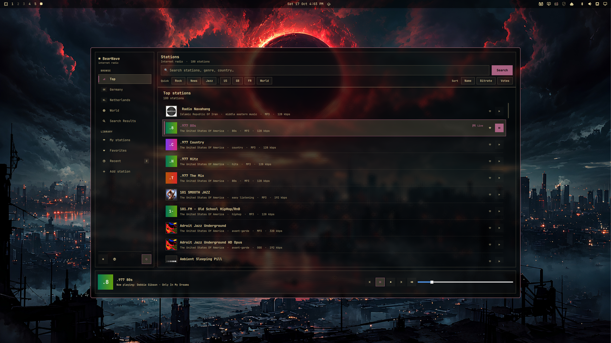
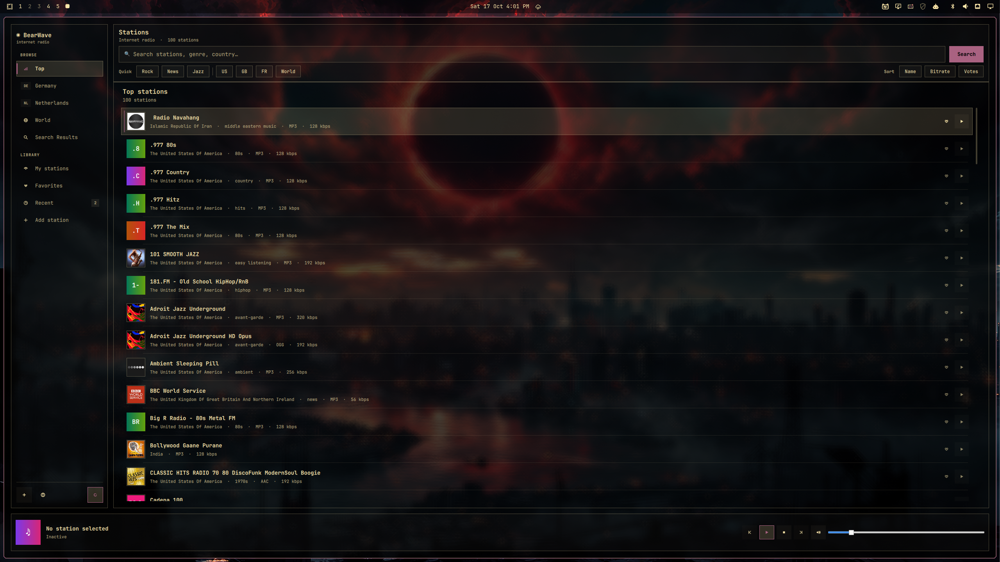
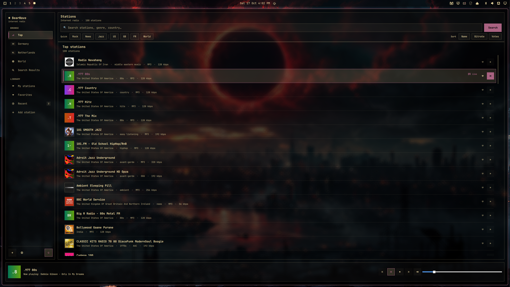
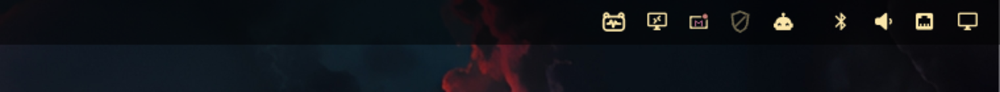

# BearWave for Omarchy


-1f6feb)


BearWave is a local Qt 6 internet-radio player designed specifically for
Omarchy and Hyprland.

[Install BearWave from the Omarchy Plugin Marketplace](https://plugins.omarchy.org/plugin.html?id=de.nerdbear.bearwave).



The application follows the current Omarchy theme from
`~/.local/state/omarchy/current/theme/colors.toml`, uses the system monospace
font, and renders its window as native frosted glass. Theme changes are picked
up while BearWave is running.

## Screenshots

### Frosted-glass window


### Station browser and playback

| Station browser | Now playing |
| --- | --- |
|  |  |

### Omarchy bar integration



## Features

- Radio Browser station search and browsing
- favorites, recent stations, and manually added streams
- ICY metadata and cover artwork
- MPRIS media controls and desktop notifications
- system-tray background playback
- German, Dutch, and Russian translations
- Omarchy palette, typography, translucent surfaces, and compact layout

## Requirements

- Omarchy with an active Hyprland session
- CMake 3.16 or newer
- Ninja or Make
- Qt 6 Base, Declarative, Multimedia, Multimedia FFmpeg, and Tools

On an Omarchy/Arch installation the development dependencies are available as:

```bash
sudo pacman -S --needed cmake ninja qt6-base qt6-declarative \
  qt6-multimedia qt6-multimedia-ffmpeg qt6-tools
```

## Local build

Run from this directory:

```bash
cmake -S . -B build-omarchy -G Ninja -DCMAKE_BUILD_TYPE=Release
cmake --build build-omarchy
ctest --test-dir build-omarchy --output-on-failure
./build-omarchy/src/bearwave
```

## Install as an Omarchy plugin

BearWave is listed in the [Omarchy Plugin Marketplace](https://plugins.omarchy.org/plugin.html?id=de.nerdbear.bearwave).
Install it from there, or add and enable the plugin directly:

```bash
omarchy plugin add https://github.com/spalencsar/bearwave_omarchy.git --enable
```

Omarchy intentionally does not execute install hooks for plugins. On first
click, the BearWave bar icon therefore opens the visible local installer in an
Omarchy terminal. You can run the same installer directly:

```bash
~/.config/omarchy/plugins/de.nerdbear.bearwave/install-omarchy.sh
```

The installer uses `omarchy pkg add` for the required Arch packages, builds
BearWave from the checked-out source, and installs the application only for the
current user below `~/.local`. It does not use Flatpak or the AUR.

After installation, left-click the bar icon to open BearWave, middle-click to
play or pause, and right-click to stop playback. The application is launched
with its own tray icon disabled so the bar does not show BearWave twice.

To remove the local application and then its plugin:

```bash
~/.config/omarchy/plugins/de.nerdbear.bearwave/uninstall-omarchy.sh
omarchy plugin remove de.nerdbear.bearwave
```

## Not using Omarchy?

This repository is the Omarchy- and Hyprland-specific edition, including the
bar widget and theme integration. For the regular multi-desktop BearWave app
(Flatpak, AUR, and source-install instructions), use the separate
[BearWave repository](https://github.com/spalencsar/bearwave). Do not install
both editions as replacements for one another: they use the same application
and MPRIS identity.

## Continuous integration

Forgejo Actions builds BearWave once and runs the complete test suite for
every push to `main`, every pull request, and manually started workflow. A
successful push build on `main` is then deployed over SSH to
`git@github.com:spalencsar/bearwave_omarchy.git`.

The Forgejo repository needs a secret named `DEPLOY_KEY` containing a
private SSH key with write access to that GitHub repository. Its public key
should be added on GitHub as a write-enabled deploy key. Pull requests and
manual workflow runs never deploy.

## Omarchy integration

BearWave recognizes Omarchy through the desktop-session environment and the
local `/usr/share/omarchy` installation. It reads these local design sources:

- palette: `~/.local/state/omarchy/current/theme/colors.toml`
- font: the Fontconfig `monospace` alias selected by Omarchy
- compositor: Hyprland supplies the blur behind BearWave's translucent window

BearWave does not modify the Omarchy or Hyprland configuration.

## Local data

- settings and stations: `~/.config/bearwave/`
- API and artwork cache: `~/.cache/bearwave/`

The configuration directory is kept owner-only. BearWave also stores its
settings, favourites, manual stations, and playback state in owner-readable
and owner-writable files, because manually added stream URLs can contain
credentials or access tokens.

Set `BEARWAVE_THEME=light` or `BEARWAVE_THEME=dark` only for temporary theme
debugging outside the normal Omarchy palette.

## Useful controls

- `Space`: play or pause
- `Ctrl+F`: focus station search
- closing the window hides BearWave in the system tray

## License

GPL-3.0-or-later. See [LICENSE](LICENSE).
