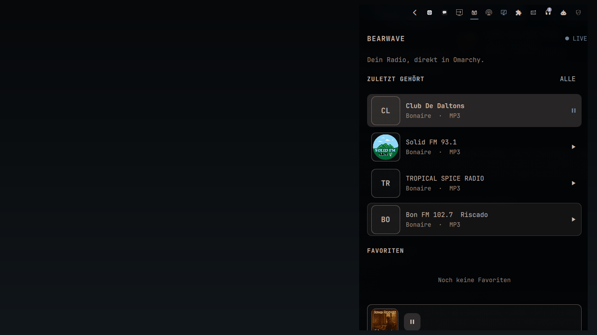
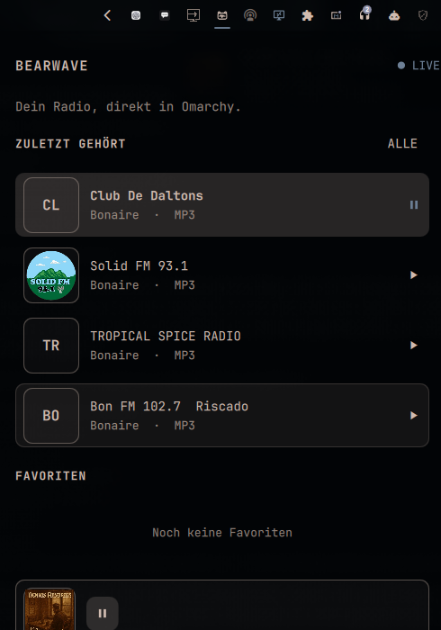
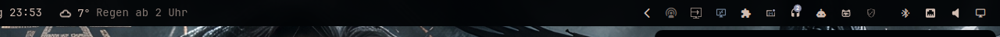

# BearWave for Omarchy


-1f6feb)


BearWave is an internet-radio app widget designed specifically for the
Omarchy bar. It feels like a compact mobile app attached to the desktop rather
than a traditional standalone window.

[Install BearWave from the Omarchy Plugin Marketplace](https://plugins.omarchy.org/plugin.html?id=de.nerdbear.bearwave).



The widget uses Omarchy's own colors, typography, spacing, controls, keyboard
panel and frosted popup surface. A small invisible Qt playback service keeps
MPRIS, metadata and audio alive while the panel is closed.

## Screenshots

### App widget



### Omarchy bar integration



## Features

- recent stations and favorites directly in the bar
- persistent mini player and an internal Now Playing view
- ICY metadata and cover artwork
- MPRIS media controls and desktop notifications
- invisible background playback without a duplicate tray icon
- native Omarchy palette, typography, controls and frosted surface

## Requirements

- Omarchy with an active Hyprland session
- CMake 3.16 or newer
- Ninja or Make
- Qt 6 Base, Declarative, Multimedia, Multimedia FFmpeg, and Tools

On an Omarchy/Arch installation the development dependencies are available as:

```bash
sudo pacman -S --needed cmake ninja qt6-base qt6-declarative \
  qt6-multimedia qt6-multimedia-ffmpeg qt6-tools
```

## Local build

Run from this directory:

```bash
cmake -S . -B build-omarchy -G Ninja -DCMAKE_BUILD_TYPE=Release
cmake --build build-omarchy
ctest --test-dir build-omarchy --output-on-failure
./build-omarchy/src/bearwave --background --no-tray
```

## Install as an Omarchy plugin

BearWave is listed in the [Omarchy Plugin Marketplace](https://plugins.omarchy.org/plugin.html?id=de.nerdbear.bearwave).
Install it from there, or add and enable the plugin directly:

```bash
omarchy plugin add https://hostbw.de/spalencsar/bearwave_omarchy.git --enable
```

Omarchy intentionally does not execute install hooks for plugins. On first
click, the BearWave bar icon therefore opens the visible local installer in an
Omarchy terminal. You can run the same installer directly:

```bash
~/.config/omarchy/plugins/de.nerdbear.bearwave/install-omarchy.sh
```

The installer uses `omarchy pkg add` for the required Arch packages, builds
BearWave from the checked-out source, and installs the application only for the
current user below `~/.local`. It does not use Flatpak or the AUR.

After installation, left-click the bar icon to open the BearWave app widget.
Choose a recent station or favorite there, use its persistent mini player, or
open the internal Now Playing page. Middle-clicking the bar icon toggles
playback. No standalone launcher or duplicate tray icon is installed.

To remove the local application and then its plugin:

```bash
~/.config/omarchy/plugins/de.nerdbear.bearwave/uninstall-omarchy.sh
omarchy plugin remove de.nerdbear.bearwave
```

## Not using Omarchy?

This repository is the Omarchy- and Hyprland-specific widget edition. For the
regular multi-desktop BearWave app
(Flatpak, AUR, and source-install instructions), use the separate
[BearWave repository](https://github.com/spalencsar/bearwave). Do not install
both editions as replacements for one another: they use the same application
and MPRIS identity.

## Omarchy integration

BearWave uses the live theme and UI primitives already provided by Omarchy
Shell. The playback service additionally recognizes the Omarchy session and
reads these local design sources for its compatibility UI:

- palette: `~/.local/state/omarchy/current/theme/colors.toml`
- font: the Fontconfig `monospace` alias selected by Omarchy
- compositor: Hyprland supplies the blur behind Omarchy's widget panel

BearWave does not modify the Omarchy or Hyprland configuration.

## Local data

- settings and stations: `~/.config/bearwave/`
- API and artwork cache: `~/.cache/bearwave/`

The configuration directory is kept owner-only. BearWave also stores its
settings, favourites, manual stations, and playback state in owner-readable
and owner-writable files, because manually added stream URLs can contain
credentials or access tokens.

Set `BEARWAVE_THEME=light` or `BEARWAVE_THEME=dark` only for temporary theme
debugging outside the normal Omarchy palette.

## Widget controls

- left-click the bar icon: open or close BearWave
- middle-click the bar icon: play or pause
- click a station row: start that station
- click the mini player: open Now Playing

## License

GPL-3.0-or-later. See [LICENSE](LICENSE).
